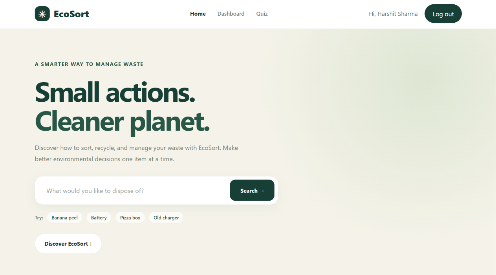
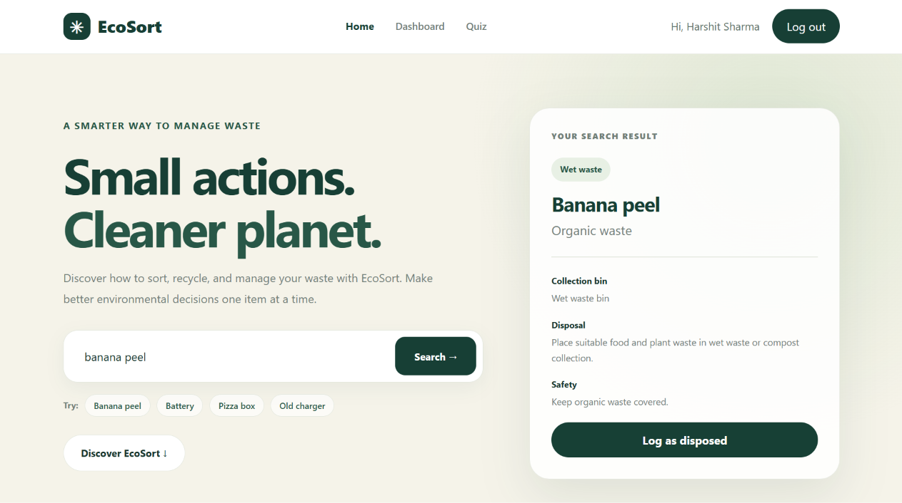
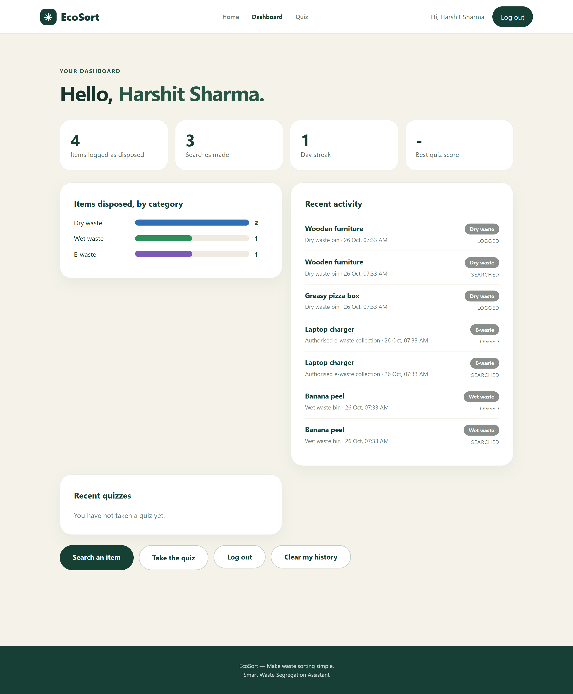
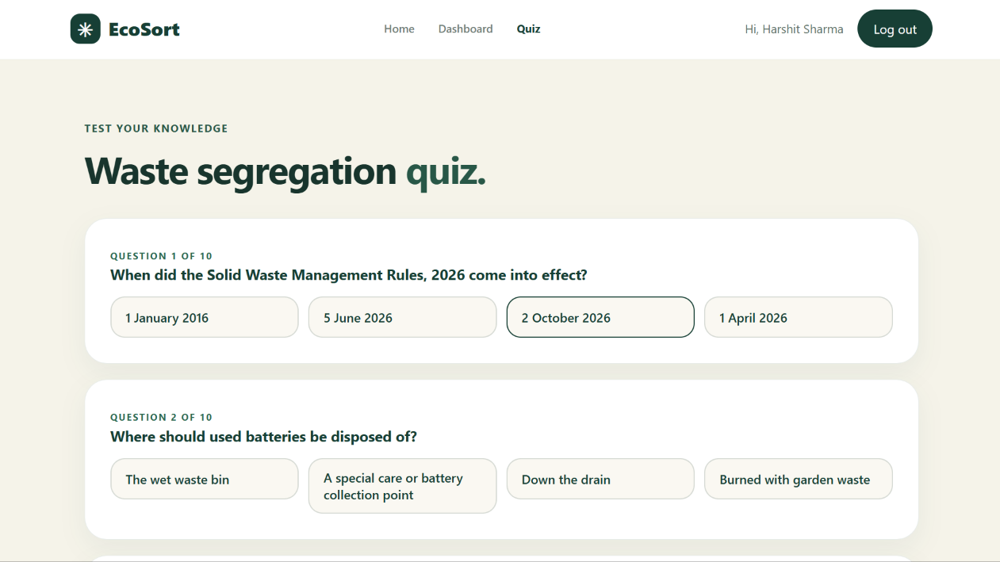
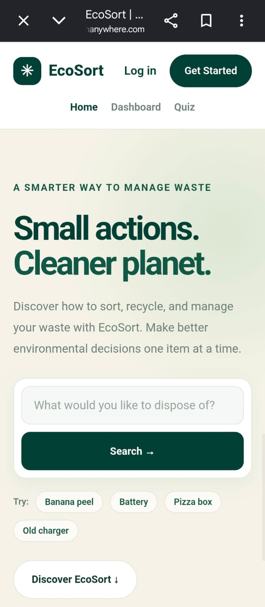
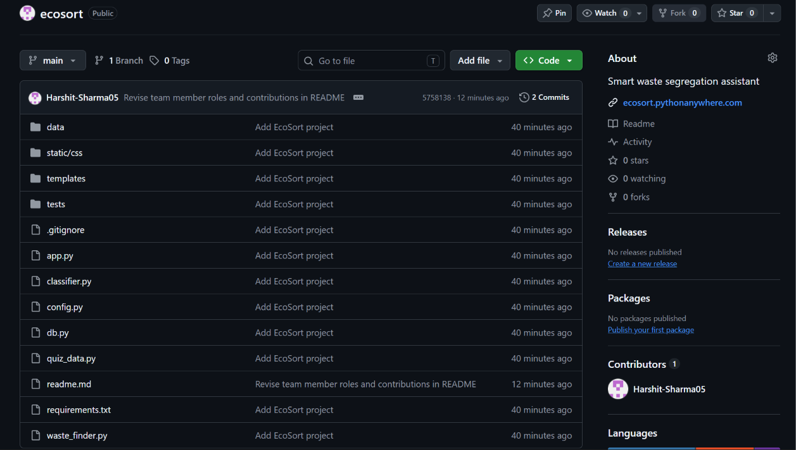

# EcoSort: Smart Waste Segregation Assistant

**Course:** CHE110 Environmental Studies, CA1 group assignment (Topic 2)
**University:** Lovely Professional University, Section K4P26HB

| | |
| --- | --- |
| **Live website** | https://ecosort.pythonanywhere.com |
| **Demo video** | [ADD VIDEO LINK] |
| **Source code** | this repository |

> The website runs on free hosting. If it is ever offline, follow
> [Run it on your computer](#run-it-on-your-computer) to start it locally.

EcoSort is a web application that tells you which bin a waste item belongs in.
Type an item such as "banana peel", "old phone charger" or "used syringe" and it
shows the waste category, the correct bin, how to dispose of it and any safety
precautions. It follows India's **Solid Waste Management Rules, 2026**.

---

## 1. The environmental problem

Most households throw food scraps, plastic, paper, used sanitary items, batteries
and broken electronics into the same bin. Mixed waste causes real damage:

- Food waste soaks into paper and plastic, so recyclable material becomes
  unrecyclable and ends up in landfills.
- Items such as tube lights, batteries, syringes and medicines can leak toxic
  substances or injure waste collectors when they are mixed with ordinary waste.
- Electronic waste thrown away with household waste loses valuable materials and
  releases harmful metals.
- Overflowing landfills and open dumps pollute soil, groundwater and air.

Many people simply do not know where an item goes, especially unusual ones like a
greasy pizza box, a CFL bulb or a thermometer. India's Solid Waste Management
Rules, 2026 (in force from 1 April 2026) require waste to be separated at the
source into four streams: **wet, dry, sanitary and special care waste**. Citizens
need a simple tool that makes this easy.

## 2. Objectives

1. Help anyone find the correct bin for a waste item in a few seconds.
2. Give safe disposal and safety advice, especially for hazardous items.
3. Teach the four-stream segregation rules through an interactive quiz.
4. Encourage the habit of segregating waste by keeping a personal history and a
   daily streak.

This supports **CO1** (defining current environmental issues and their problems)
and **CO3** (the role of environmental policies, practices and techniques in
reducing pollution).

## 3. Features

- **Waste finder.** Understands item names, alternative names, spelling mistakes
  and keywords. It answers with the category, bin, disposal method and safety note.
- **"Which one do you mean?" questions.** If an item could go in different bins
  (for example "bottle", "bulb" or "pizza box") it asks which version you mean.
- **Guided questions for unknown items.** If it has never heard of an item, it asks
  what the item is made of and whether it is hazardous, then gives an answer.
- **Hazard-first safety rule.** Words such as battery, needle, medicine or
  chemical always send an item to *special care waste*, never to the dry bin.
- **Accounts.** Register and log in to keep a private history.
- **Dashboard.** Shows counts, a day streak, a chart by category and recent activity.
- **Quiz.** 10 random questions from a bank of 20 on segregation and the 2026 rules.
  Scores are saved for logged-in users.
- **Works on phones.** The layout adapts to small screens.

## 4. How it works

When a user searches, the classifier tries these steps in order:

1. **Exact match** on an item name or alternative name (about 900 items are stored).
2. **Phrase match** (for example "old banana peel" contains "banana peel").
3. **Spelling correction** ("banan peel" becomes "banana peel").
4. **Keyword rules**, where hazardous keywords take priority over everything else.
5. **Ambiguous items** return a short list so the user can choose.
6. **Unknown items** start the guided questions, and the search is saved to a
   small log so new items can be added later.

The result is shown as one of: wet waste, dry waste, sanitary waste, special care
waste or e-waste.

## 5. Tools and technologies

| Area | Tool |
| --- | --- |
| Language | Python 3.12 |
| Web framework | Flask 3.1.3 (with Jinja2 templates) |
| Database | SQLite |
| Front end | HTML, CSS, JavaScript |
| Data | JSON file of materials and waste items |
| Testing | Python `unittest` (25 automated tests) |
| Hosting | PythonAnywhere (free plan) |
| Version control | Git and GitHub |

Security measures: passwords are stored as hashes, forms are protected against
CSRF attacks, login cookies are marked Secure and HTTP-only, and the log of
unknown searches is size-limited.

## 6. Utility and applications

- **Households**: quick answers while sorting daily waste.
- **Schools and colleges**: classroom or campus awareness, and a quiz for students.
- **Residents' associations and offices**: a shared reference for segregation rules.
- **Awareness campaigns**: a simple, free tool that anyone can open on a phone.

## 7. Limitations and future work

- Results come from a stored list of about 900 items and keyword rules, not from
  image recognition. Very unusual items may need the guided questions.
- Currently English only.
- The rules followed are the national ones. Local municipal bodies may use slightly
  different colour codes or collection schedules, so users should always follow
  their local instructions.

Possible improvements: photo-based identification using machine learning, Hindi and
Punjabi language support, a map of nearby recycling and e-waste collection points,
and more items.

## 8. Screenshots

Add your images to a folder named `screenshots` in this repository using these
names.

| Home and search | Search result |
| --- | --- |
|  |  |

| Dashboard | Quiz |
| --- | --- |
|  |  |

| On a phone | GitHub repository |
| --- | --- |
|  |  |

## 9. Social media coverage

| Platform | Link to post | Date posted | Views / likes |
| --- | --- | --- | --- |
| Instagram | [ADD LINK] | | |
| YouTube | [ADD LINK] | | |
| LinkedIn | [ADD LINK] | | |
| Facebook | [ADD LINK] | | |
| X (Twitter) | [ADD LINK] | | |

## 10. Run it on your computer

You need Python 3.10 or newer.

```
python -m venv venv
venv\Scripts\activate          (Windows)   |   source venv/bin/activate   (Mac/Linux)
pip install -r requirements.txt
python app.py
```

Open http://127.0.0.1:5000. Always start it with `python app.py` for local use. The
first run creates `data/ecosort.db` (accounts and history) and `data/.secret_key`
(used to sign login cookies). Both are private and are excluded from this
repository by `.gitignore`.

**Run the tests:**

```
python -m unittest discover -s tests -t .
```

The tests use a temporary database, so real data is never touched.

**Deploying:** the site is hosted on PythonAnywhere using a Flask web app with
manual configuration, a virtual environment from `requirements.txt`, a small WSGI
file that imports `app`, and Force HTTPS switched on.

## 11. Project structure

| Path | What it does |
| --- | --- |
| `app.py` | Flask routes: search, accounts, dashboard, quiz, CSRF protection |
| `classifier.py` | The classification engine described in section 4 |
| `waste_finder.py` | Connects the classifier to the web pages |
| `db.py` | SQLite tables for users, activity and quiz results |
| `quiz_data.py` | The 20 quiz questions |
| `data/waste_data.json` | Materials and waste items |
| `templates/`, `static/` | HTML pages and CSS |
| `tests/` | Automated tests |

## 12. Team

| Name | Registration No. | Roll No. | Part of the project | What I contributed |
| --- | --- | --- | --- | --- |
| Harshit Sharma | 12618072 | RK4P26HBA04 | Developer and deployment | Built the app (classifier, accounts, dashboard, quiz), tested it, hosted it on PythonAnywhere, set up the GitHub repository |
| Ayushi Katiyar | 12628607 | RK4P26HBA05 | Testing, content, video and outreach | Tests the live site and reports problems, checks the quiz questions against the official 2026 rules, adds new waste items to the data file, takes the screenshots, records and edits the demo video, posts it on social media and tracks the views |

## 13. Use of AI tools

AI assistance (Claude by Anthropic) was used for programming help, debugging,
testing, interface fixes and checking facts about the 2026 rules. The team
reviewed, ran and tested the results and can explain how the project works.

## 14. References

- Solid Waste Management Rules, 2026, Ministry of Environment, Forest and Climate
  Change, Government of India (notified January 2026, in force from 1 April 2026).
- Press Information Bureau (PIB) announcements on the rules.

The quiz facts follow these sources. Check the official notification before
changing them.
